<div align="center">


### The memory and organizational layer for everything you've encountered at work.

Faber remembers the docs you open, reads them with a **local** model, organizes them into projects on its own, and finds anything again by what you remember about it.

[Get started](#get-started) · [Tour](#a-quick-tour) · [Privacy](#privacy-first) · [How it works](#how-it-works) · [CLI](#cli) · [Contributing](#development)

<br>

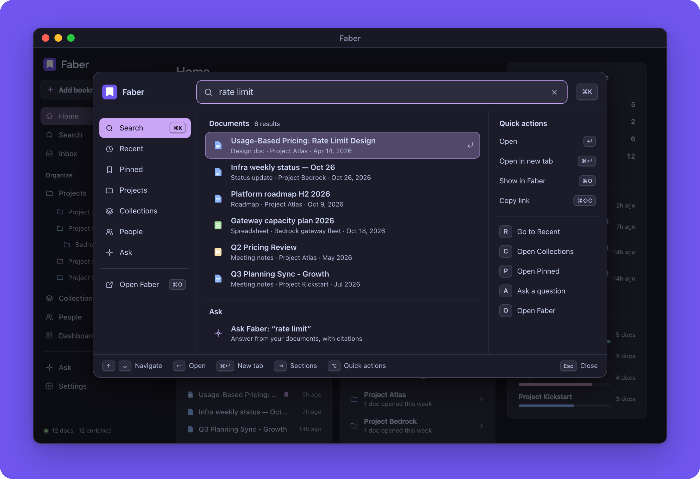

</div>

<br>

You don't remember titles. You remember *"the pricing doc from Maya's team, around the Q2 planning meeting, the one about token buckets."* That's how Faber lets you search.

<table>
<tr>
<td width="25%" valign="top"><b>1 · Work normally</b><br><sub>A Chrome extension notices the Google Docs, Slides and Sheets (or any site you allow) that you actually spend time on.</sub></td>
<td width="25%" valign="top"><b>2 · Faber remembers</b><br><sub>A local model reads each one: a summary, the type of doc, people, projects, teams, tags, and roughly when it was written.</sub></td>
<td width="25%" valign="top"><b>3 · Faber organizes</b><br><sub>Projects are inferred and nested, decisions are pulled out, and look-alikes are flagged. Your corrections always win.</sub></td>
<td width="25%" valign="top"><b>4 · Find anything</b><br><sub>Search, browse or ask, from the app, any web page, or anywhere on your Mac with <kbd>⌥Space</kbd>.</sub></td>
</tr>
</table>

## A quick tour

### One launcher, everywhere

Press <kbd>⌘K</kbd> in the app, <kbd>⌘⇧K</kbd> on any web page, or <kbd>⌥Space</kbd> anywhere on your Mac. Search documents, projects, collections and people in one list. Browse into a project, ask a question, or open the original, all from the keyboard.

<p align="center">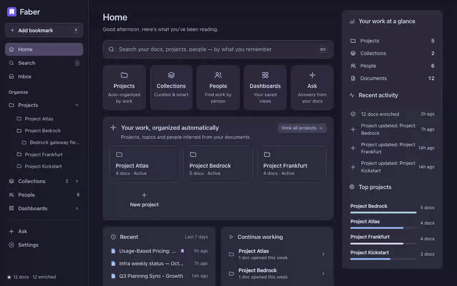</p>

On a Mac, a tiny menu-bar app puts the same launcher a keystroke away from any app, not just the browser:

<p align="center">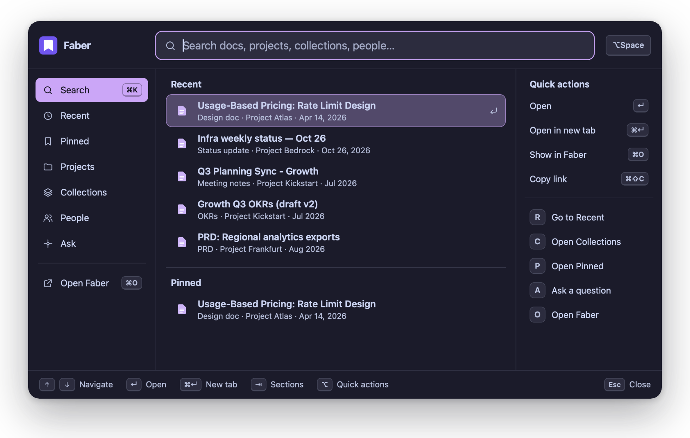</p>

### Search the way you remember

Keyword search (SQLite FTS5) and semantic search (local embeddings) are fused into one ranking, boosted by how often and how recently you opened something. Filter by type, person, project, tag or time, and save any search as a view.

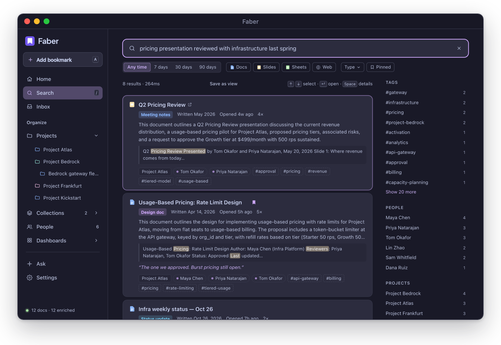

### Projects that organize themselves

Faber infers projects from what it reads and nests them into a hierarchy ("Bedrock gateway fleet" sits inside "Project Bedrock"). Every project gets a workspace with:
- an AI overview, and decisions found in its docs;
- key documents, recent activity, people and subprojects;
- search and Ask scoped to that project.

Rename, merge, move or dismiss anything. **Your corrections always win** and survive re-enrichment. The **Inbox** suggests what Faber isn't sure about: new projects, look-alike names, and low-confidence classifications.

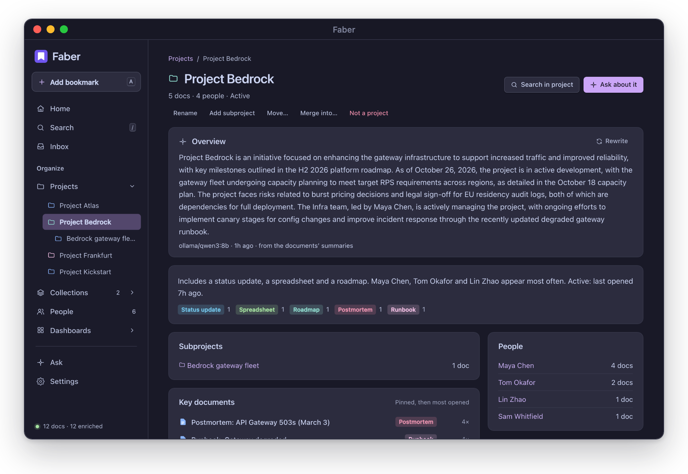

### Ask your documents

Answers come only from your own documents, with numbered citations, across everything or within one project. When the documents don't cover something, Faber says so plainly. You can ask follow-up questions in the same conversation.

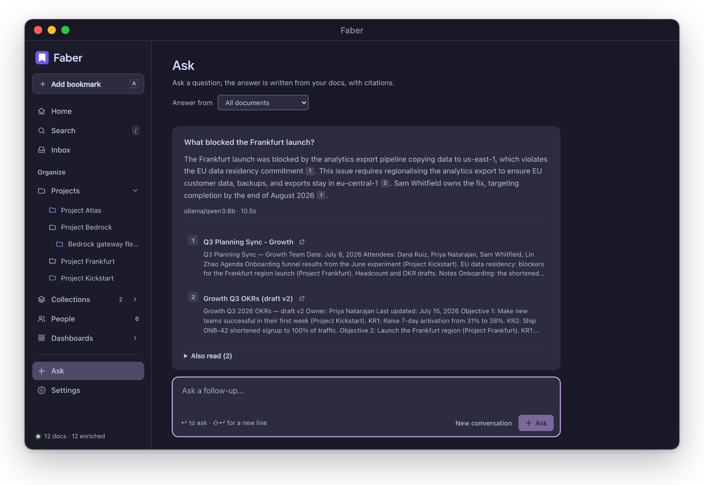

### Everything about a document, at a glance

<table>
<tr>
<td width="50%">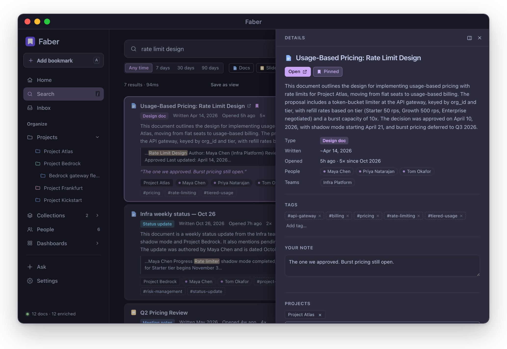</td>
<td width="50%">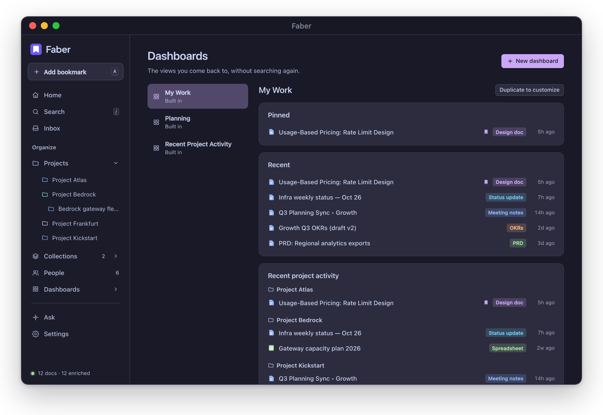</td>
</tr>
<tr>
<td align="center"><sub>Summary, type, people, tags, your note, and its projects</sub></td>
<td align="center"><sub>Dashboards: My Work, Planning, Project Activity, or your own</sub></td>
</tr>
</table>

### A home that knows what you're working on

It shows recent docs, active projects and pinned items, plus "continue working" and the things you used to rely on.

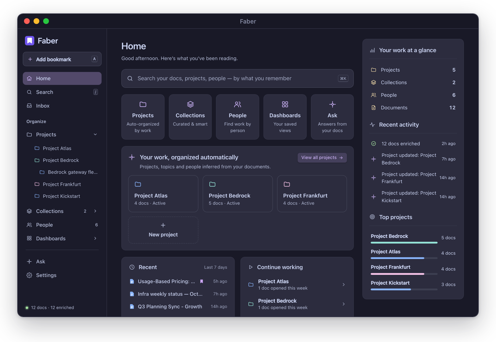

### Capture without thinking about it

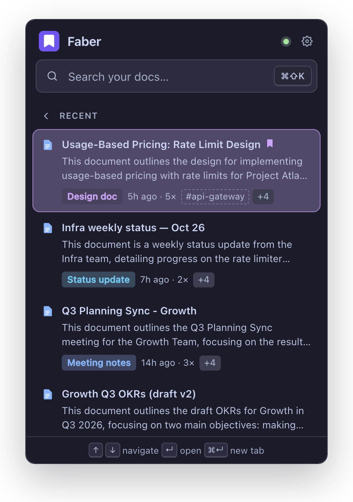

The Chrome extension tells you whether the page you're on is saved. You can save it, pin it, tag it, or leave a one-line note ("the one we approved"). Pages you spend time on are remembered automatically, but **only on sites you've turned on**.

The extension also brings the launcher (<kbd>⌘⇧K</kbd>) to every page, and adds a `faber` keyword to the address bar.

Prefer not to install it? Use the **Add** button, a bookmarklet, the CLI, or the API.

<br clear="right">

### Make it yours

Choose Catppuccin **Mocha**, **Macchiato**, **Frappé** or **Latte**, or follow the system. Pick any accent and a comfortable or compact density. The app, the launcher, the extension and the macOS panel all change together, and accents are adjusted where needed so text stays readable.

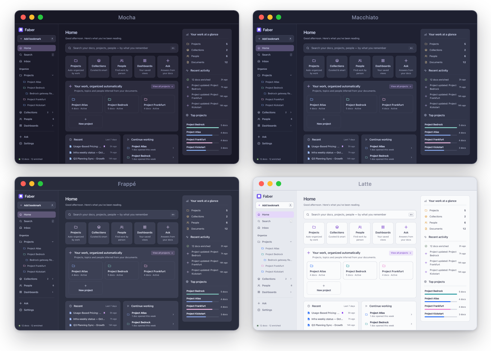

## Privacy first

Faber stores confidential work documents, so its defaults are conservative:

- 🔒 **Nothing is captured until you enable it.** Every watch rule starts off. Incognito tabs are never captured, and only tabs you actually look at count.
- 💻 **Everything stays on your machine.** All data lives in one SQLite file in `~/.faber`. The server only listens on your own machine (loopback), and the config refuses anything else.
- 🧠 **AI runs locally by default.** The default is Qwen 3 via [Ollama](https://ollama.com). Remote providers (Anthropic, OpenAI-compatible) are **blocked** until you set `privacy.allow_remote = true`.
- 🛡️ **Websites can't read it.** Cross-origin requests are rejected, the `Host` header must be a loopback name (this blocks DNS rebinding), and browser extensions must be approved before they can call the API.

<details>
<summary><b>Security details</b></summary>

<br>

- **Extensions must be paired.** Any installed extension can reach localhost, so the daemon only serves extensions you've approved in Settings, or ones listed in `daemon.allowed_extension_ids`.
  - An extension can't approve itself.
  - Requests from an extension that doesn't identify itself are refused. (Chrome omits `Origin` on extension GETs.)
  - Faber's own extension sends its reads as `POST` with `x-faber-method: GET`.
- **The launcher can't be read by the page it's shown on.** On a web page it is an extension frame. It only loads anything when the extension itself opened it, using a one-time ticket from the shortcut. A site that frames it on its own gets an empty page.
- **The macOS panel only shows the daemon's pages.** Other links open in your browser, and only the daemon's own page can ask the app to open anything.
- **Limits.** Pairing stops other extensions from calling the API directly. But an extension you've given access to all sites can still open Faber's pages in a tab and read what they show, as it could with any site. Only install extensions you trust.
- **Shared collections carry no content.** Exports include URLs, titles, your notes and your manual tags. They don't include document text, AI summaries, auto tags or doc types.

</details>

## Get started

You need [Bun](https://bun.sh) ≥ 1.2, [Ollama](https://ollama.com) and Chrome. Faber is tested on macOS (Apple silicon); Linux should work.

```bash
# 1. Local models (about 10 GB; on machines with < 16 GB RAM use qwen3:4b and set it in config.toml)
ollama pull qwen3:8b
ollama pull qwen3-embedding

# 2. The daemon
git clone https://github.com/asweeney86/faber
cd faber && bun install
bun faber serve                 # → http://127.0.0.1:7777, leave it running
```

**3. Install the extension.**
1. Run `bun run build:extension`.
2. Open `chrome://extensions`, turn on *Developer mode*, choose **Load unpacked**, and pick `packages/extension/build`.
3. Open its popup once.
4. Approve it in the web app under **Settings → Capture & Sources**, or with `bun faber extensions approve <id>`.

**4. Choose what to watch.** In **Settings → Capture & Sources**, turn on Google Docs, Slides, Sheets or Calendar. One-click presets cover Notion, Confluence & Jira, GitHub, Linear, Drive and Figma. You can add any other site as a custom rule.

**5. Optional: seed from your history.** Chrome keeps about 90 days:

```bash
bun faber import-chrome --list              # find your work profile
bun faber import-chrome --profile "Work"    # or the directory, e.g. --profile "Profile 19"
```

The extension fetches text for those docs in the background, and the daemon enriches them, most-visited first. That takes about 8 seconds per document with `qwen3:8b` on an M1 Max.

> [!TIP]
> **Just want to look around?** Load demo data into a throwaway home. With Ollama running, Qwen enriches it in about two minutes:
> ```bash
> export FABER_HOME=$(mktemp -d)
> bun faber demo && bun faber serve
> ```
> Not using Ollama yet? Run the demo with the offline `fake` providers instead:
> ```bash
> printf '[embed]\nprovider = "fake"\nmodel = "fake-embed"\n[enrich]\nprovider = "fake"\nmodel = "fake-enrich"\n' > "$FABER_HOME/config.toml"
> ```

### The native macOS launcher

This is a small menu-bar app that opens the launcher from anywhere on your Mac. It needs macOS 13+ and the Xcode command line tools (`xcode-select --install`).

```bash
bun run build:macos
open "packages/macos/build/Faber Launcher.app"
```

- Press <kbd>⌥Space</kbd> to show it. <kbd>Esc</kbd> or clicking elsewhere hides it.
- Documents open in your default browser.
- If the daemon isn't running, the panel says so, and it recovers by itself when the daemon comes back.

To keep it, move it to `/Applications`, then turn on **Open at login** from the menu-bar icon. Settings:

```bash
defaults write dev.faber.launcher hotkey "cmd+shift+space"           # another shortcut (then reopen the app)
defaults write dev.faber.launcher daemonURL "http://127.0.0.1:7788"  # a daemon on another port
```

## Using it

| Where | How |
|---|---|
| **Web app** | `http://127.0.0.1:7777`: Home, Search (<kbd>/</kbd>), Inbox, Projects, Collections, People, Dashboards, Ask, Settings |
| **Launcher** | <kbd>⌘K</kbd> in the app, <kbd>⌘⇧K</kbd> on any page, <kbd>⌥Space</kbd> on macOS. Inside it: <kbd>↑</kbd><kbd>↓</kbd> move, <kbd>↵</kbd> open, <kbd>⌘↵</kbd> new tab, <kbd>⇥</kbd> sections, <kbd>⌥R/C/P/A/O</kbd> quick actions, <kbd>Esc</kbd> back or close |
| **Extension popup** | Is this page saved? Save it, or edit its pin, projects, tags and note |
| **Address bar** | type `faber`, then a space |
| **CLI** | `bun faber search "pricing doc from infra"` · `bun faber ask "what blocked the Frankfurt launch?"` |

<details>
<summary><b>Adding docs without the extension</b></summary>

<br>

- **Web app:** the **Add** button (or press <kbd>a</kbd>) takes a URL and, optionally, the document's text.
  - For a Google doc, use *File → Download → Plain text* and drop the file in.
  - With text, the doc is summarized, tagged and searchable right away.
- **Bookmarklet:** drag it from **Settings** to your bookmarks bar.
- **CLI:** `bun faber add <url> --title "…" --file doc.txt`
- **API:** `POST /api/docs` with `{ "url", "title", "content", "note", "tags", "pinned", "collection_id" }`.

There's one short note per document on purpose. Faber is not a note-taking app.

</details>

## How it works

```
 Chrome extension ──visits + text──▶ daemon (Bun, 127.0.0.1:7777) ──▶ SQLite (~/.faber)
   │ watches only the sites                  │   ├─ HTTP API + web UI           ├─ docs, visits, notes, tags
   │ you enable; fetches Google              │   ├─ enrichment queue            ├─ enrichments (versioned by model)
   │ export text with your session           │   ├─ project inference           ├─ projects + your corrections
   │                                         │   └─ hybrid search               └─ chunks + embeddings, full-text index
   └─ launcher (⌘⇧K), popup, omnibox         ▼
                                 Ollama (local, default)        Anthropic / OpenAI-compatible / claude CLI
 macOS menu-bar app (⌥Space) ──▶ qwen3:8b · qwen3-embedding      (opt-in, see Privacy)
```

The extension does the fetching because it has your Google cookies; the daemon never talks to Google. Google Docs, Slides and Sheets expose plain-text export URLs, so you don't need Drive API access or an OAuth client, and no IT approval.

<details>
<summary><b>Configuration</b></summary>

<br>

`~/.faber/config.toml` is created, with comments, on first run. `FABER_HOME` changes the directory. Wrong types fail loudly at startup.

```toml
[embed]                       # keep local; changing the model requires `faber reindex`
provider = "ollama"           # ollama | openai-compatible | fake
model = "qwen3-embedding"

[enrich]                      # swap freely; every enrichment records which model made it
provider = "ollama"           # ollama | anthropic | openai-compatible | claude-cli | fake
model = "qwen3:8b"

# [ask]                       # optional: a stronger model just for Ask
# provider = "anthropic"
# model = "claude-opus-5-5"
# api_key = "$ANTHROPIC_API_KEY"

[privacy]
allow_remote = false          # must be true for anthropic / claude-cli / remote URLs

[search]
# min_semantic = 0.48         # similarity floor for semantic matches (tuned for qwen3-embedding)
```

- **`anthropic`** uses the official SDK. With no `api_key`, it reads `ANTHROPIC_API_KEY` (or `ANTHROPIC_AUTH_TOKEN`).
- **`claude-cli`** shells out to `claude -p`, so a Claude Code subscription works without an API key.
- **`openai-compatible`** works with LM Studio, vLLM, llama.cpp server, OpenRouter, Groq and similar (`base_url` + optional `api_key`).
- **`fake`** is deterministic and offline, for tests and demos.

</details>

## CLI

| Command | What it does |
|---|---|
| `faber serve` | Run the daemon: API, web UI and background enrichment |
| `faber status` | Counts, queue state, providers, Ollama reachability |
| `faber import-chrome [--profile X] [--list] [--dry-run]` | Seed from Chrome history |
| `faber add <url> [--file text.txt] [--title T]` | Add a document by hand, optionally with its text |
| `faber search <query> [--mode hybrid\|keyword\|semantic] [--limit N] [--json]` | Search |
| `faber ask <question>` | Answer from your documents, with citations |
| `faber projects` | Projects as a tree (with your corrections) |
| `faber enrich [--limit N]` | Drain the enrichment queue in the foreground |
| `faber collections` · `faber export <id> [file]` · `faber import <file>` | List, export and import collections |
| `faber extensions [approve\|remove <id>]` | Manage which browser extensions may use the API |
| `faber reindex` · `faber requeue` | Re-embed everything, or re-run enrichment (after changing models) |
| `faber demo` · `faber config` | Load demo documents · print the config file path |

Run them with `bun faber …` from the repo.

## Development

```bash
bun install
bun run typecheck       # all packages
bun run test            # unit + HTTP integration tests
bun run test:e2e        # Playwright: the web UI and the real extension in Chromium, against a seeded daemon
bun run test:macos      # builds the native launcher and runs its self-test (shows a panel for ~12s)
bun run serve           # daemon with --watch
bun run dev:extension   # rebuild the extension on save and auto-reload it in Chrome
```

For `dev:extension`, load `packages/extension/build` once via **Load unpacked**. After that, every save under `packages/extension/src`, `static` or `packages/shared/src` rebuilds and reloads it. Run `bun run build:extension` when you're done to go back to a normal build.

| Package | |
|---|---|
| [`packages/shared`](packages/shared) | Wire types, API client, theme engine, URL and watchlist helpers (no runtime deps) |
| [`packages/core`](packages/core) | Everything stateful: schema, providers, enrichment, search, projects, collections, people, Ask |
| [`packages/daemon`](packages/daemon) | HTTP server, security checks, CLI, demo data |
| [`packages/ui`](packages/ui) | The launcher, shared by the app, the extension and the macOS panel |
| [`packages/web`](packages/web) | React web app served by the daemon (Bun HTML import, no build step) |
| [`packages/extension`](packages/extension) | Chrome MV3 extension |
| [`packages/macos`](packages/macos) | Native menu-bar launcher (Swift/AppKit) |

End-to-end tests run against offline `fake` providers and demo data, so they need neither Ollama nor Google. The screenshots here come from the demo data, enriched locally by `qwen3:8b`. Regenerate them with `bun scripts/screenshots.ts --daemon <url>`. The product requirements are in [docs/PRD.md](docs/PRD.md).

<details>
<summary><b>Limitations</b></summary>

<br>

- Google Sheets export covers the first tab only.
- Owner and last-editor metadata isn't available without the Drive API, so people come from the document text.
- Calendar linking reads the open event in Google Calendar's UI, so it may need updates when Google changes it.
- Search is brute-force over in-memory vectors, which is comfortable up to tens of thousands of documents.
- Keyword search splits on spaces and punctuation, so for Chinese and Japanese text it matches whole runs rather than words inside them. Semantic search still works.
- Corrections are per project and per document; bulk reorganization beyond merge and move is future work.
- The macOS app is ad-hoc signed, for the Mac that built it.

</details>

## License

[Apache-2.0](LICENSE)
